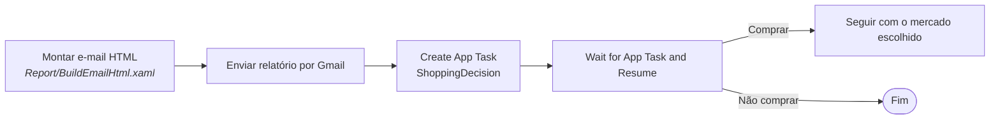

# Action App – ShoppingDecision

App do **Action Center** (feito no **Studio Web**) em que o usuário vê a comparação de preços e escolhe em
qual mercado comprar. O robô cria a tarefa depois de montar o relatório e espera a resposta.

## Onde entra no fluxo

## Esquema da ação (Action schema)

Os nomes abaixo são os que o robô usa. Mantenha-os iguais no Studio Web.

**Entradas (In)**, preenchidas pelo robô:

| Nome | Tipo | Valor enviado pelo `Main.xaml` |
|------|------|--------------------------------|
| `RelatorioHtml` | Text | `htmlBody`, o mesmo HTML do e-mail |
| `Mercados` | Text | Nomes dos mercados com `status = "ok"`, um por linha (`vbLf`) |
| `MercadoSugerido` | Text | Mercado com o menor `totalNumero` |
| `Resumo` | Text | Uma linha por mercado, ex.: `Mercado X – R$ 152,30` |

**Saídas (Out)**, preenchidas pelo usuário:

| Nome | Tipo | Uso |
|------|------|-----|
| `MercadoEscolhido` | Text | Mercado escolhido na lista |
| `Observacao` | Text | Comentário livre (opcional) |

**Resultados (Outcomes)**: `Comprar` e `NaoComprar` (sem acento, como o Studio Web gerou).

## Tela

1. **Título**: "Onde comprar?"
2. **HTML** (controle *HTML content*) ligado a `RelatorioHtml`. Se a sua versão do Studio Web não tiver esse
   controle, use um **Label** ligado a `Resumo`.
3. **Dropdown** "Mercado":
   - Fonte da lista: `Mercados.Split({vbLf}, StringSplitOptions.RemoveEmptyEntries)`
   - Valor inicial: `MercadoSugerido`
   - Valor ligado a `MercadoEscolhido`, obrigatório
4. **Text area** "Observação", ligada a `Observacao`.
5. **Botões**:
   - **Comprar**: regra de concluir a tarefa com o resultado `Comprar` (valida o dropdown antes).
   - **Não comprar**: concluir com o resultado `NaoComprar`.

## Como criar no Studio Web

1. No Studio Web, **Create New → App → RPA app** e renomeie o projeto para `ShoppingDecision`. A edição de
   apps roda pelo UiPath Assistant local: aceite o acesso do Chrome a "apps e serviços neste dispositivo".
2. Clique com o botão direito no projeto → **Add to project → Action**. Isso cria o `ActionSchema`, que pode
   ser preenchido com o Autopilot a partir das tabelas acima.
3. **Generate page** monta a tela e os workflows dos botões. Ajuste conforme a seção anterior.
4. **Publish** e faça o deploy do app na pasta `ComparePricesMarkets` do Orchestrator, a mesma do processo.
5. Teste em **Action Center → Tasks** criando uma tarefa de teste, ou rodando o processo.

## Ligação no robô

Feito no `Main.xaml`, depois do envio do e-mail do relatório (sequência "Decisão de compra – Action Center"):

- Pacote `UiPath.Persistence.Activities` 1.13.0 e `supportsPersistence: true` no `project.json`.
- `browser` recebe `Nothing` antes da espera: um `UiElement` não pode ser salvo quando o job é suspenso.
- `mercados`, `mercadoSugerido` e `resumo` são montados a partir de `marketResults` (só mercados com `status = "ok"`
  entram na lista; o sugerido é o de menor `totalNumero`).
- Se nenhum mercado teve sucesso, a tarefa não é criada (log de aviso).
- Senão: **Create App Task** (título "Onde comprar? – dd/MM/yyyy", entradas `RelatorioHtml`, `Mercados`,
  `MercadoSugerido`, `Resumo`) → **Wait for App Task and Resume** → log com o resultado (`taskAction`), o mercado e a observação → e-mail de confirmação para `SendTo`
  ("Decisão de compra: Comprar/Não comprar – dd/MM/yyyy", com o mercado, o total dele e a observação).
  A tarefa fica na variável `appTask` (`UserActionData`).

O app foi escolhido no Studio Desktop: **ShoppingDecision** 1.0.1, pasta `Shared/ShoppingDecision`. As saídas vão
para as variáveis `mercadoEscolhido` e `observacao`, que aparecem no log junto com o resultado.

## Estado atual no Studio Web

- Solução e projeto de app **ShoppingDecision**. Versão 1.0.1 publicada (feed Shared do tenant) e implantada na
  pasta de solução `Shared/ShoppingDecision` do Orchestrator, como processo `ShoppingDecision`
  (`ShoppingDecision.webApp.ShoppingDecision`). O deploy de solução cria a própria pasta dentro de `Shared` e não
  deixa escolher outra; por isso o app não fica em `ComparePricesMarkets`.
- Esquema criado com o Autopilot, com os nomes acima.
- Página **MarketAnalysisFormPage**, salva no snapshot "Tela em portugues com dropdown":
  - Título "Onde comprar?" e textos em português.
  - Blocos *HTML Report* (Container5) e *Markets* (Container6) ocultos (Hidden `True`): mostravam texto cru.
    Mostrar o HTML formatado exigiria o controle **Custom HTML**, que usa JavaScript.
  - Dropdown **MercadoLista** (rótulo "Mercado onde comprar", obrigatório, mensagem "Escolha um mercado"):
    - List source: `New ListSource(Of String)(ActionProperties.Mercados.Split({vbCr, vbLf}, StringSplitOptions.RemoveEmptyEntries).Select(Function(s) s.Trim()).Where(Function(s) s <> "").ToList())`
    - Default selected value: `ActionProperties.MercadoSugerido`
  - Botão **Comprar**: desabilitado com `String.IsNullOrWhiteSpace(MarketAnalysisFormPage.MercadoLista.Value)`.
  - Botão **Não comprar**: sempre habilitado.
  - Nos dois workflows dos botões, `MercadoEscolhido` = `Controls.MarketAnalysisFormPage.MercadoLista.Value`.
- Health analyzer sem problemas.

### Dicas do editor

- Os campos de propriedade aceitam expressões VB: texto precisa de aspas (`"Comprar"`).
- O editor não tem botão de salvar e Ctrl+S não funciona: use **Version control → Create snapshot** antes de sair
  ou recarregar. Sem isso, as edições podem se perder.
- Nomes de controles apagados continuam reservados (por isso o dropdown se chama `MercadoLista`).
