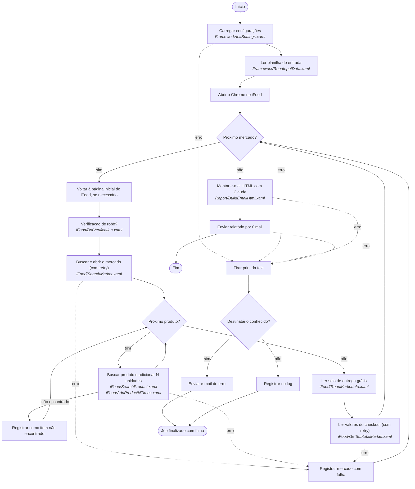

# Fluxo do processo – Comparação de Preços Ifood

Este documento descreve, passo a passo, o que o robô faz. O ponto de entrada é o [`Main.xaml`](Main.xaml).

## Visão geral

O robô lê uma lista de compras e uma lista de mercados em uma planilha do Google. Para cada mercado, ele
monta o mesmo carrinho no iFood e lê os valores do checkout (subtotal, taxas, entrega, total e pedido
mínimo). No final, envia por e-mail um relatório comparando os mercados lado a lado.

## Diagrama

## Etapas

| # | Etapa | Workflow | O que faz |
|---|-------|----------|-----------|
| 1 | Carregar configurações | `Framework/InitSettings.xaml` | Lê as abas **Settings** e **Assets** de `Data/Config.xlsx`. Os assets (`SheetURL`, `SendTo`) vêm do Orchestrator. Para o processo se faltar alguma configuração. |
| 2 | Ler planilha de entrada | `Framework/ReadInputData.xaml` | Baixa a planilha do Google, lê as abas **Produtos** e **Mercados** e apaga o arquivo temporário. |
| 3 | Abrir o iFood | `Main.xaml` | Abre uma nova janela do Chrome na página inicial do iFood. |
| 4 | Verificação de robô | `iFood/BotVerification.xaml` | Se o iFood mostrar a verificação de segurança, abre uma caixa de mensagem pedindo para o usuário resolvê-la e espera a página voltar. |
| 5 | Abrir o mercado | `iFood/SearchMarket.xaml` | Busca o nome do mercado e abre o primeiro resultado. Tenta de novo se falhar. |
| 6 | Montar o carrinho | `iFood/SearchProduct.xaml`, `iFood/AddProductNTimes.xaml` | Para cada produto selecionado, busca e adiciona a quantidade pedida. Se o carrinho tiver itens de outro mercado, esvazia antes. Produtos sem resultado vão para a lista de itens não encontrados. |
| 7 | Entrega grátis | `iFood/ReadMarketInfo.xaml` | Lê quanto falta para a entrega grátis, quando o mercado mostra esse selo. |
| 8 | Valores do checkout | `iFood/GetSubtotalMarket.xaml` | Abre o carrinho e lê subtotal, taxa de serviço, taxa e opção de entrega, total e aviso de pedido mínimo. Tenta de novo se falhar. |
| 9 | Montar o relatório | `Report/BuildEmailHtml.xaml` | Envia os resultados em JSON para a API do Claude (via Integration Service), com o prompt de `Data/EmailPrompt.txt`. O Claude só formata o e-mail: não calcula nem compara valores. |
| 10 | Enviar o relatório | `Main.xaml` | Envia o e-mail pelo Gmail para o destinatário do asset `SendTo`. |

## Entradas

**Planilha do Google** (link no asset `SheetURL`):

- Aba **Produtos**: colunas `Item` e `Quantidade`, com uma caixa de seleção na primeira coluna. Um produto
  só entra na lista se estiver marcado e tiver uma quantidade inteira maior que zero.
- Aba **Mercados**: coluna `Mercado`, com o nome do mercado do jeito que ele aparece na busca do iFood.

**`Data/Config.xlsx`**:

- Aba **Settings**: URL do iFood, nomes de abas e colunas da planilha, modelo e limite de tokens do Claude,
  caminho do prompt e assunto do e-mail.
- Aba **Assets**: assets lidos da pasta `ComparePricesMarkets` do Orchestrator (`SheetURL`, `SendTo`).

## Saídas

- **E-mail de relatório**: uma comparação em HTML com um bloco por mercado. Quando um mercado falha, ele
  aparece como "falhou", com o motivo.
- **E-mail de erro**: enviado com um print da tela quando o processo inteiro falha.

## Regras de exceção

| Situação | O que acontece |
|----------|----------------|
| Falha em um mercado (não abriu, checkout não carregou etc.) | O mercado é registrado como falho e o robô **segue para o próximo**. |
| Produto não encontrado | Vai para a lista de itens não encontrados e o mercado continua normalmente. |
| Verificação de robô do iFood | O robô **pausa e pede ajuda ao usuário**. Se a página não voltar, o mercado falha. |
| Falta de configuração, planilha inválida, erro na API ou no envio | Print da tela, e-mail de erro (se o destinatário for conhecido) e o job termina **com falha**. |

## Sistemas envolvidos

- **Google Chrome** + **iFood** (automação de interface)
- **Google Sheets / Drive**: planilha de entrada
- **Gmail** (UiPath GSuite): envio dos e-mails
- **Claude API** (UiPath Integration Service): formatação do e-mail
- **UiPath Orchestrator**: assets e execução do job

## Observações

- O processo **precisa de um usuário presente**, por causa da verificação de robô do iFood
  (`requiresUserInteraction` no `project.json`).
- Os valores do relatório são exatamente os que o iFood mostra, com a primeira opção de entrega selecionada.
